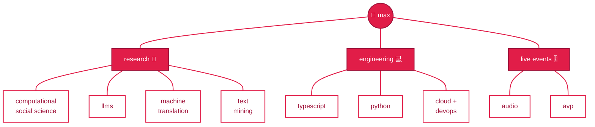
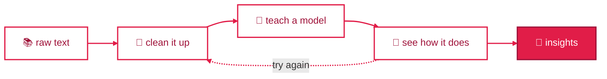
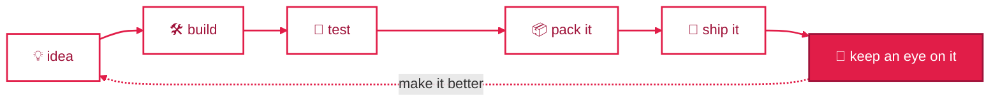
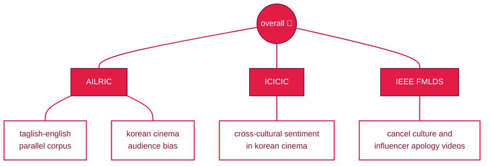
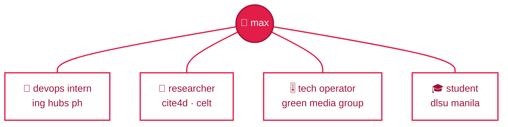

# 🍓 hello! i'm max

**software engineer · undergraduate researcher · live events operator**

*cs, software technology @ de la salle university manila*

[portfolio](https://YOUR-PORTFOLIO-URL) · [resume](https://animo.li/mbchavez-resume)

---

### what i'm about

### how i like to work

**research**

**software engineering**

### papers, accepted so far

### right now

*always learning, always building* 🍓

more about me → [portfolio](https://YOUR-PORTFOLIO-URL) · [resume](https://animo.li/mbchavez-resume)

